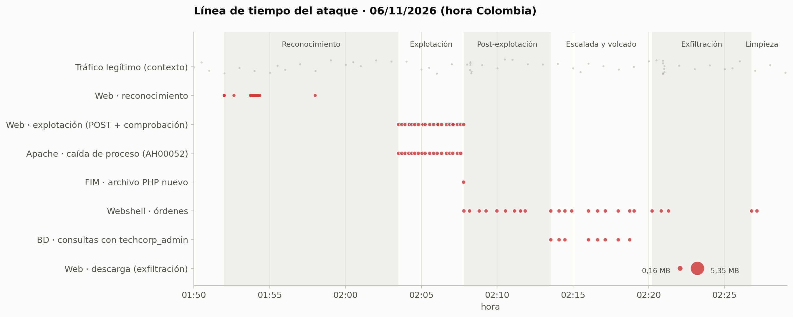
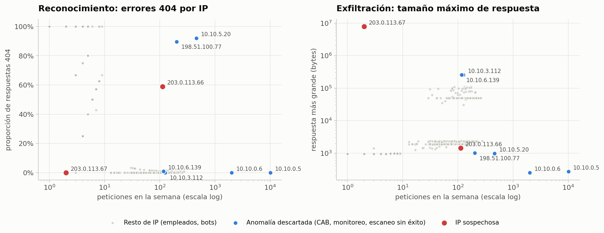
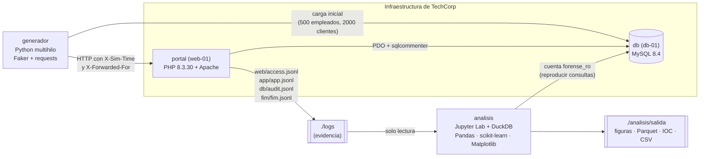

# Laboratorio de Ingeniería Forense y Big Data: incidente «PHP2Shell» en TechCorp

Entorno **autocontenido en Docker Compose** para la respuesta ante incidentes. Simula una semana de operación del portal interno de la empresa ficticia **TechCorp**. Mezcla unas **180 000 líneas de log** de tráfico legítimo con un ataque simulado de ejecución remota tipo **PHP2Shell (CVE-2026-109618)**. Después, un notebook de Jupyter reconstruye el incidente y responde: **cuándo, dónde, cómo, desde qué IP y qué registros** se consultaron y extrajeron.

> **Laboratorio académico.** Todos los datos (500 empleados, 2000 clientes) son ficticios, generados con Faker (`es_CO`). El ataque **no usa ningún exploit real**: el portal reconoce el patrón de petición en modo laboratorio y un simulador deja la misma huella forense que dejaría el ataque real (ver [Qué es simulado](#qué-es-simulado-y-qué-es-real)). Las IP «de Internet» pertenecen a rangos reservados para documentación (RFC 5737).

### Vista previa de los resultados





El notebook ejecutado, con todas sus salidas, se puede ver directamente en [`analisis/notebooks/analisis_forense.ipynb`](analisis/notebooks/analisis_forense.ipynb).

---

## Arquitectura



| Servicio | Imagen | Función |
|---|---|---|
| `db` | `mysql:8.4` | Base de datos `techcorp` (tablas `empleados`, `clientes`, `tickets`) con tres cuentas: `techcorp_app` (portal, mínimo privilegio), `techcorp_admin` (mantenimiento heredado) y `forense_ro` (solo lectura, para el analista). |
| `portal` | `php:8.3.30-apache` | Portal interno: login, clientes, directorio, tickets, reportes y exportación CSV. Registra **cada petición, error, sentencia SQL y cambio de archivos** en JSON. |
| `generador` | `python:3.12-slim` | Puebla la BD y simula 7 días de uso por parte de los empleados, el ruido y las falsas alarmas, y guarda la línea base de los logs. Corre una sola vez con `docker compose up` y termina; Jupyter espera a que acabe. |
| `analisis` | `python:3.12-slim` | Jupyter Lab con **DuckDB** (motor SQL columnar), Pandas, scikit-learn (Isolation Forest), Matplotlib y Seaborn. Monta la evidencia **en solo lectura**. |

> **¿Por qué DuckDB y no PySpark/ELK?** Con 2 núcleos y unos GB de RAM, DuckDB procesa estos cientos de miles de eventos (y también millones) en segundos sin la JVM ni un clúster. Lee JSON y Parquet de forma paralela y vectorizada, y el SQL del notebook se traslada casi sin cambios a Spark SQL si el volumen creciera a terabytes. Ver [Escalar a PySpark](#escalar-a-pyspark-opcional).

---

## Requisitos

* Docker Engine 24+ con **Docker Compose v2** (`docker compose version`).
* ~3 GB de disco para imágenes y ~2 GB de RAM libre mientras corre la simulación.
* Puertos libres en `127.0.0.1`: **8080** (portal) y **8888** (Jupyter). Se cambian en `.env`.

## Puesta en marcha (dos comandos)

```bash
cp .env.example .env              # valores por defecto listos; ajuste puertos o tamaño si quiere
docker compose up -d --build      # ≈ 5–8 min la primera vez en un portátil de 2 núcleos
```

Eso es todo. `up` hace, en orden:

1. Levanta la base de datos (`db`) y el portal (`portal`) y espera a que estén *healthy*.
2. Corre el **generador** una sola vez: puebla la BD con Faker, simula la semana normal de tráfico (sin el ataque, porque `SIN_INCIDENTE=1` viene por defecto), guarda la **línea base** de los logs y termina.
3. Levanta **Jupyter** solo cuando el generador terminó bien. Cuando el comando devuelve el control, todo está listo.

Si se vuelve a ejecutar `docker compose up -d` (por ejemplo, después de reiniciar el equipo), el generador detecta que el laboratorio ya está preparado y sale en un segundo, sin volver a simular.

Luego abra en el navegador (Docker no puede abrirlo por usted; guárdelas como marcadores):

| Qué | Dirección | Acceso |
|---|---|---|
| **Jupyter** (los dos notebooks ya abiertos en pestañas) | <http://127.0.0.1:8888/lab?token=forense2026> | token `JUPYTER_TOKEN` del `.env` |
| **Portal** de TechCorp | <http://127.0.0.1:8080> | usuario `demo`, contraseña `TechCorp2026*` (cualquier empleado entra con esa misma contraseña) |

```bash
docker compose ps                     # db y portal "healthy"; generador "exited (0)"; analisis "running"
docker compose logs generador         # progreso y resumen de la simulación
```

* **Figuras listas para diapositivas** (PNG a 200 ppp): `analisis/salida/figuras/`.
* **Resultados del caso**: `analisis/salida/` contiene `cadena_custodia.csv`, `super_timeline.csv`, `iocs.json`, `registros_expuestos_*.csv`, el *data lake* Parquet (`lake/`) y `analisis_forense.html`.
* **Prueba rápida** (≈ 2 min): ponga `ESCALA=0.3` en `.env` antes del `up`.

### La presentación: notebook por notebook

Todo lo demás se hace desde Jupyter, ejecutando **una celda a la vez** (`Shift + Enter`) mientras explica:

1. **`notebooks/00_ataque_en_vivo.ipynb`**: usted hace de atacante. Entra por la página de subir la foto de perfil (`/empleados/foto.php`), deja la puerta trasera y roba la base de datos, y en cada paso ve qué es real, qué es simulado y qué huella quedó en los logs. El ataque es una **simulación controlada** (el portal reconoce el patrón; no hay exploit real).
2. **`notebooks/analisis_forense.ipynb`**: el ingeniero forense reconstruye lo que usted acaba de hacer, solo con los logs.

**Se puede repetir cuantas veces quiera.** La primera celda del notebook del ataque borra la puerta trasera de la corrida anterior y **recorta los logs a la línea base** (la semana normal, guardada en `logs/.linea_base.json`), así que el forense siempre ve **un solo ataque**.

Sin navegador, el notebook forense también se puede ejecutar y exportar a HTML (después de hacer el ataque):

```bash
docker compose exec analisis jupyter nbconvert --to notebook --execute --inplace notebooks/analisis_forense.ipynb
docker compose exec analisis jupyter nbconvert --to html --output-dir salida notebooks/analisis_forense.ipynb
```

### Variante sin notebook en vivo

Si prefiere que el generador inyecte también el ataque (y deje el solucionario en `simulacion/`), deje vacío `SIN_INCIDENTE=` en `.env` **antes** del primer `up` (o tras `./reiniciar_laboratorio.sh`). En esa variante no use `00_ataque_en_vivo.ipynb`: se sumaría un segundo ataque a los logs.

### Demostración en vivo (opcional)

```bash
# Artefactos que el ataque dejó en el disco del servidor web
docker diff techcorp-portal | grep -v emp_            # A /var/www/html/uploads/avatars/thumb_8f3a.php
docker exec techcorp-portal stat -c '%y %U %s bytes %n' /var/www/html/uploads/avatars/thumb_8f3a.php

# Uso inusual de la cuenta de mantenimiento, directamente en la auditoría
grep -c '"db_user":"techcorp_admin"' logs/db/audit.jsonl
```

### Repetir desde cero

```bash
./reiniciar_laboratorio.sh            # borra contenedores, BD, logs y resultados, y vuelve a preparar todo
```

El script deja el laboratorio como recién instalado y ejecuta `docker compose up -d --build`, que vuelve a simular la semana. Para repetir **solo el ataque** no hace falta: basta con volver a ejecutar `00_ataque_en_vivo.ipynb` desde el principio.

> **No borre `logs/*.jsonl` con el portal encendido.** Apache mantiene el archivo abierto y seguiría escribiendo en el archivo eliminado, de modo que la evidencia se perdería. El script lo hace en el orden correcto.

### Apagar

```bash
docker compose down        # conserva la BD (volumen db_data) y los logs
docker compose down -v     # además borra la BD
```

---

## Estructura

```
techcorp-forense-lab/
├── docker-compose.yml
├── .env.example
├── reiniciar_laboratorio.sh
├── db/init/                       # esquema y cuentas de MySQL
├── portal/                        # PHP 8.3.30 + Apache
│   ├── Dockerfile, entrypoint.sh
│   ├── apache/techcorp.conf       # log de acceso en JSON, mod_remoteip, mod_unique_id
│   ├── php/techcorp.ini
│   ├── lab/                       # andamiaje del laboratorio (fuera del docroot)
│   │   ├── bootstrap.php          #   reloj simulado, log JSON, manejador de errores
│   │   ├── simulador_php2shell.php#   huella del exploit (sin exploit)
│   │   ├── webshell_simulada.php  #   órdenes de un conjunto cerrado, sin ejecución real
│   │   └── linea_base.php         #   guarda/restaura la línea base de los logs (ataque repetible)
│   └── www/                       # la aplicación: login, clientes, empleados, tickets, reportes…
├── generador/                     # Python: poblar_bd.py, trafico.py, incidente.py, main.py
├── analisis/
│   ├── Dockerfile, requirements.txt
│   ├── iniciar.sh, espacio_presentacion.json  # arranque de Jupyter con los dos notebooks abiertos
│   ├── notebooks/00_ataque_en_vivo.ipynb   # el ataque paso a paso (opcional, modo presentación)
│   ├── notebooks/analisis_forense.ipynb
│   ├── contexto/                  # registro de cambios (CAB) e inventario de red de TechCorp
│   └── salida/                    # resultados (figuras, Parquet, IOC, CSV, HTML)
├── logs/{web,app,db,fim}/         # EVIDENCIA (se genera al simular)
├── logs/.linea_base.json          # tamaño de los logs al terminar la semana normal
└── simulacion/                    # solucionario_incidente.json (solo para el docente)
```

---

## Las cuatro fuentes de evidencia

Todas en **JSON Lines** (un evento por línea), con la hora en **UTC** (`...Z`). El notebook las pasa a hora de Colombia (UTC−5).

**`logs/web/access.jsonl`**: registro de acceso de Apache (formato `LogFormat` personalizado):
```json
{"ts":"2026-11-06T07:03:28.986Z","server":"web-01","vhost":"portal.techcorp.local","request_id":"avtijs4te4uLtdrGyZIEUwAAAAA","client_ip":"203.0.113.66","method":"POST","uri":"/empleados/foto.php","query":"","protocol":"HTTP/1.1","status":500,"bytes_sent":211,"bytes_received":387027,"duration_us":40004,"content_type":"multipart/form-data; boundary=9e5b4715…","user_agent":"python-requests/2.32.3","referer":"-","user":"-"}
```

**`logs/app/app.jsonl`**: eventos de la aplicación (`login_success`, `login_failed`, `access_denied`, `not_found`, `php_error`, `export_generated`, `child_crash`…):
```json
{"ts":"2026-11-06T07:03:28.986Z","level":"CRITICAL","component":"apache","server":"web-01","request_id":null,"client_ip":null,"user":null,"method":null,"uri":null,"event":"child_crash","message":"AH00052: child pid 9678 exit signal Segmentation fault (11)","context":{"signal":11,"simulado":true}}
```

**`logs/db/audit.jsonl`**: auditoría SQL (inspirada en el *audit log* de MySQL/Percona). El texto SQL lleva el `request_id` HTTP en un comentario (*sqlcommenter*). `row_ids` es una extensión del laboratorio con los id devueltos:
```json
{"ts":"2026-11-06T07:16:00.935Z","server":"db-01","record_type":"Query","connection_id":86,"db_user":"techcorp_admin","client_host":"web-01","database":"techcorp","command_class":"select","tables":["clientes"],"sqltext":"SELECT * FROM clientes ORDER BY id LIMIT 500 OFFSET 0 /*request_id='avtHH0rIKu1KPmYJyqwPLQAAAAI',route='/uploads/avatars/thumb_8f3a.php'*/","status":0,"rows_sent":500,"rows_affected":0,"duration_ms":14.778,"row_ids":[1,2,3,…]}
```

**`logs/fim/fim.jsonl`**: monitor de integridad de archivos (al estilo de Wazuh *syscheck*):
```json
{"ts":"2026-11-06T07:07:46.545Z","agent":"fim-web-01","server":"web-01","event":"file_added","path":"/var/www/html/uploads/avatars/thumb_8f3a.php","size":207,"sha256":"a0a401e8e0260ef38cb542a3c867cb717d66b364bdecb99cc81182522e153c1e","owner":"www-data","mode":"0644","process":"apache2"}
```

---

## El escenario

### Tráfico legítimo (el «ruido»)
* **Empleados** de 6 áreas con comportamientos distintos según el rol: comerciales consultan clientes, soporte gestiona tickets, RR. HH. revisa el directorio y los salarios, Finanzas usa los reportes. Trabajan en horario de oficina, algunos por VPN, y hay turnos de tarde y noche en soporte. Cometen errores normales: contraseñas mal escritas, marcadores viejos (404) y accesos sin permiso (403).
* **Monitoreo**: Zabbix (cada minuto) y un Nagios heredado (cada 5 min), que además genera *warnings* de PHP.
* **Ruido de Internet**: bots que buscan `/wp-login.php`, `/.env`, `/.git/config`…
* Algunos errores 500 esporádicos (bloqueos de BD) y fotos de perfil subidas por los empleados.

### Falsas alarmas (el analista debe descartarlas)
| Cuándo (hora Colombia) | Qué | Por qué parece sospechoso | Por qué no lo es |
|---|---|---|---|
| mar 03/11, 03:00 | Escaneo de vulnerabilidades desde 10.10.5.20 | Ráfaga de cientos de 404 de madrugada | Aprobado en el registro de cambios **CAB-2026-114** |
| mié 04/11, 10:12 | Exportación de toda la base de clientes (Finanzas) | Lectura masiva y respuesta grande | Usuario autenticado, rol autorizado, **CAB-2026-117** |
| sáb 07/11, 15:21 | Escaneo + fuerza bruta desde 198.51.100.77 | Ráfaga de 404 y *logins* fallidos desde Internet | Nunca obtuvo nada más allá del formulario de login |
| lun 09/11, 16:41 | Exportación de clientes (Gerencia) | Lectura masiva | Autorizado, **CAB-2026-121** |

### El incidente (viernes 06/11 de madrugada) · *spoiler*
1. **Reconocimiento** (01:52): navegación, `robots.txt` y ~380 rutas con `gobuster/3.6` desde **203.0.113.66**.
2. **Explotación** (~02:04): ráfaga de **subidas de archivo a `/empleados/foto.php`** (la página de la foto de perfil) con el campo `PHP_SESSION_UPLOAD_PROGRESS` y cuerpos de 300–900 KB (el patrón de PHP2Shell). Como la falla está en PHP y no en la aplicación, **se dispara antes de iniciar sesión**. Los procesos de Apache «se caen» (500 + `AH00052 Segmentation fault`) hasta que al intento 19 aparece **`/uploads/avatars/thumb_8f3a.php`** (FIM).
3. **Post-explotación**: órdenes en Base64 por la webshell (`id`, `uname -a`, `ls`, `cat config/database.php`).
4. **Escalada y consulta masiva**: con las credenciales de **`techcorp_admin`** leídas del archivo de configuración, vuelca **las 2000 filas de `clientes`** (en 4 bloques) y **los 500 empleados** (incluidos salario y hash de contraseña) a `/tmp/.d/`.
5. **Exfiltración**: comprime los volcados y el docroot (código y fotos de perfil) y los descarga desde **otra IP, 203.0.113.67** (`curl`).
6. **Limpieza**: borra `/tmp/.d*` y deja la webshell como persistencia.

`simulacion/solucionario_incidente.json` guarda la «verdad» de lo que se inyectó. La última celda del notebook compara sus conclusiones con ese archivo.

---

## El notebook forense (`analisis/notebooks/analisis_forense.ipynb`)

El hilo conductor son las **expresiones regulares**: convierten los registros de texto en datos (`regexp_extract`, `regexp_matches`, `regexp_replace` en DuckDB y `re` en Python). Cada vez que se usa una, un recuadro «Expresión regular en uso» la explica pieza por pieza y la prueba sobre la evidencia.

| Sección | Técnica | Figura para la presentación |
|---|---|---|
| 0.1 Expresiones regulares | La herramienta central del caso: chuleta de piezas y visor `ver_regex()` que resalta lo que atrapa cada patrón en líneas reales de la evidencia | — |
| 1. Preservación | SHA-256 de cada archivo, cadena de custodia, montaje en solo lectura | — |
| 2. Ingesta Big Data | DuckDB `read_json` con esquema explícito, data lake Parquet/ZSTD particionado, comparación de tamaño y velocidad | — |
| 3. Línea base | Volumen por día y hora, códigos de estado, endpoints | `fig01_mapa_calor_actividad.png` |
| 4. Anomalías | Perfil por IP, **z robusto** (mediana/MAD) + **Isolation Forest**, ráfagas de 404, respuestas fuera del p99, **triage** contra el registro de cambios | `fig02_bytes_enviados.png`, `fig03_ips_anomalas.png` |
| 4.6 Firmas con regex | Siete firmas (`regexp_matches`) sobre toda la semana: las generales atrapan ruido, las específicas solo al atacante, las de inyección SQL y `../` dan cero | `fig08_firmas_regex.png` |
| 5. Vector de entrada | Subidas de archivo anómalas en la página de la foto, **ASOF JOIN** con las caídas de Apache, URI nuevas, evento FIM | — |
| 6. Post-explotación | Decodificación Base64 de las órdenes de la webshell y mapeo a **MITRE ATT&CK** | — |
| 7. Web ↔ BD | `request_id` extraído del SQL (*sqlcommenter*), uso anómalo de `techcorp_admin`, **registros exactos expuestos** y validación por **reproducción** de las consultas con `forense_ro` | `fig04_bd_filas_por_cuenta.png`, `fig05_clientes_expuestos.png` |
| 8. Exfiltración | Bytes por IP y archivo, pivote por artefacto (no solo por IP) | — |
| 9. Super-timeline | Integración de las 4 fuentes | `fig06_linea_tiempo_ataque.png` |
| 10. Conclusiones | Tabla cuándo/dónde/cómo/quién/qué, IOC (`iocs.json`), recomendaciones y Ley 1581 de 2012 | `fig07_cifras_clave.png` |
| 11. Cierre | Re-verificación de hashes y comparación con el solucionario | — |

---

## Qué es simulado y qué es real

| Elemento | ¿Real? | Detalle |
|---|---|---|
| PHP 8.3.30, Apache, MySQL, sesiones, subidas | **Real** | Imágenes oficiales sin modificar |
| Logs de acceso, aplicación, auditoría y FIM | **Real** | Los escribe el portal al atender cada petición |
| Consultas a la BD (también las del atacante) | **Real** | Datos ficticios; la auditoría registra lo que de verdad devolvió MySQL |
| Archivos en disco (webshell, `/tmp/.d/*.tsv`, `.tgz`) | **Real** | `docker diff techcorp-portal` los muestra (mientras no se borren) |
| Hora de los eventos | Simulada | El generador envía `X-Sim-Time` para «vivir» 7 días en minutos |
| IP de los clientes | Simulada | El generador envía `X-Forwarded-For` (el portal confía en él como si hubiera un balanceador) |
| Corrupción de memoria / exploit de PHP2Shell | **Simulado** | `lab/simulador_php2shell.php` reconoce el patrón (POST multipart con `PHP_SESSION_UPLOAD_PROGRESS`) y responde 500 + `AH00052` hasta el intento N |
| Ejecución de órdenes | **Simulada** | `lab/webshell_simulada.php` solo acepta un conjunto **cerrado** de órdenes con salidas predefinidas. Las órdenes `mysql` se traducen a SELECT fijos; no hay shell ni SQL libre |

**Malas prácticas intencionales del escenario** (son parte de la lección): PHP sin parchear, `expose_php = On`, ejecución de PHP permitida en `/uploads`, credenciales en texto plano dentro del docroot y una cuenta de mantenimiento con todos los privilegios.

**Seguridad del laboratorio:** los puertos se publican solo en `127.0.0.1` (cámbielo con `BIND_ADDR` si necesita mostrarlo en la red local). El modo laboratorio (`LAB_MODE=1`) solo existe en este portal. No reutilice estas contraseñas.

---

## Parámetros de la simulación (`.env`)

| Variable | Por defecto | Efecto |
|---|---|---|
| `SIM_INICIO` | `2026-11-03T00:00:00-05:00` | Inicio de la semana simulada |
| `SIM_DIAS` | `7` | Días simulados |
| `INCIDENTE_INICIO` | `2026-11-06T01:52:00-05:00` | Inicio del ataque (debe caer dentro de la ventana) |
| `ESCALA` | `1.0` | Proporción de empleados activos (0.3 = prueba rápida) |
| `HILOS` | `12` | Hilos del generador |
| `SEMILLA` | `2026` | Semilla de Faker y de la simulación (reproducible) |
| `SIN_INCIDENTE` | `1` | `1` = solo la semana normal (el ataque se hace desde el notebook en vivo); vacío = el generador también inyecta el ataque |
| `LAB_EXPLOIT_ATTEMPTS` | `19` | Intentos que «necesita» el exploit simulado |

> Si cambia las fechas, actualice también `analisis/contexto/registro_cambios.csv` (las falsas alarmas autorizadas).

## Rendimiento medido

En un portátil antiguo (Intel Celeron 1000M, 2 núcleos, 7 GB de RAM), con los valores por defecto:

| Etapa | Resultado |
|---|---|
| Carga de datos con Faker | 500 empleados, 2000 clientes y 1800 tickets en ~20 s |
| Simulación de 7 días | **80 366 peticiones HTTP** en 6,5 min (~215 peticiones/s, 12 hilos) |
| Evidencia generada | **180 315 líneas** (web 80 366 · BD 88 516 · aplicación 11 240 · FIM 193), 83 MB |
| Notebook completo | ~1 min: ingesta, *data lake* Parquet (83 MB de JSON → ~5 MB), Isolation Forest y 7 figuras |

## Escalar a PySpark (opcional)

Las consultas del notebook son SQL estándar. Con Spark serían, por ejemplo:

```python
from pyspark.sql import SparkSession
spark = SparkSession.builder.appName("forense").getOrCreate()
web = spark.read.json("/evidencia/logs/web/*.jsonl")       # o el data lake: spark.read.parquet("salida/lake/web")
web.createOrReplaceTempView("web")
spark.sql("""SELECT client_ip, COUNT(*) AS peticiones, AVG(CAST(status = 404 AS INT)) AS tasa_404
             FROM web GROUP BY client_ip ORDER BY tasa_404 DESC""").show()
```

## Referencias

* NIST SP 800-86, *Guide to Integrating Forensic Techniques into Incident Response*.
* ISO/IEC 27037:2012, identificación, recolección, adquisición y preservación de evidencia digital.
* MITRE ATT&CK: T1595, T1190, T1505.003, T1082, T1083, T1552.001, T1078, T1005, T1074.001, T1560.001, T1041, T1070.004.
* Ley Estatutaria 1581 de 2012 y Decreto 1377 de 2013 (protección de datos personales, Colombia).
* Aviso de seguridad de PHP sobre PHP2Shell (CVE-2026-109618 / CVE-2026-109619), corregido en PHP 8.2.35, 8.3.36, 8.4.27 y 8.5.12 (21 de octubre de 2026).
